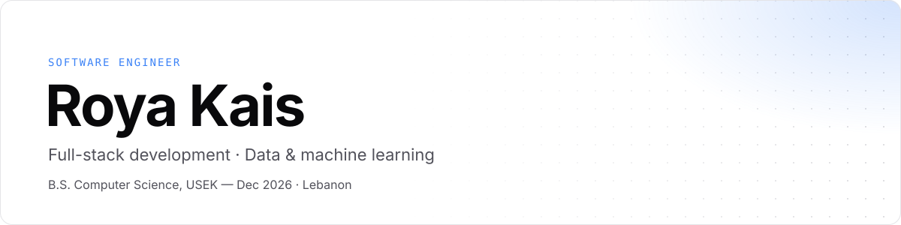

<picture>
  <source media="(prefers-color-scheme: dark)" srcset="./assets/header-dark.svg" />
  
</picture>

  
  
  

### About

Final-year Computer Science student at **Holy Spirit University of Kaslik (USEK)**, graduating December 2026. I build things that actually run: relational databases, typed full-stack web apps, and machine-learning models taken from raw data all the way to a live product.

Currently building **HomeFit**, my final year project, and going deeper into Java, the JVM and data structures & algorithms.

### Selected work

| Project | What it is | Stack |
| :-- | :-- | :-- |
| **[F1 2026 Prediction Lab](https://github.com/royakais/F1_prediction)** · [demo](https://f1-prediction-lab8.onrender.com/) | End-to-end ML system predicting Formula 1 finishing positions, served by a Flask API to an interactive site. [Pipeline →](https://github.com/royakais/MachineLearning-F1) | Python, scikit-learn, Pandas, Flask |
| **HomeFit** · *in progress* | No-equipment home-workout mobile app with machine-learning features on top of guided plans. | Mobile, ML |
| **[BNF Interpreter](https://github.com/royakais/BNF-Interpreter)** | A small language from a BNF grammar: lexer, recursive-descent parser, AST and evaluator, with a GUI that visualises the syntax tree. | Java, Swing |
| **[Vee Coffee Shop DBMS](https://github.com/royakais/DBMS-VeeCoffeeShop)** | Relational database for a 16-branch coffee chain, from ER diagram to normalised schema. | SQL |
| **[Guess the Capital](https://github.com/royakais/GuessTheCapital)** | Keyboard-first desktop quiz with 96 countries and a timed, animated dark UI. | Java, Swing |
| **[Portfolio](https://github.com/royakais/royakais-portfolio)** | My personal site. | Next.js, TypeScript, Tailwind |

### Stack

Also: Pandas · NumPy · Matplotlib · Power BI · R · GitHub Actions

### Contact

Open to junior software engineering and data roles, in Lebanon and remote. Reach me on [LinkedIn](https://linkedin.com/in/royakais) or at [royakais@yahoo.com](mailto:royakais@yahoo.com).
