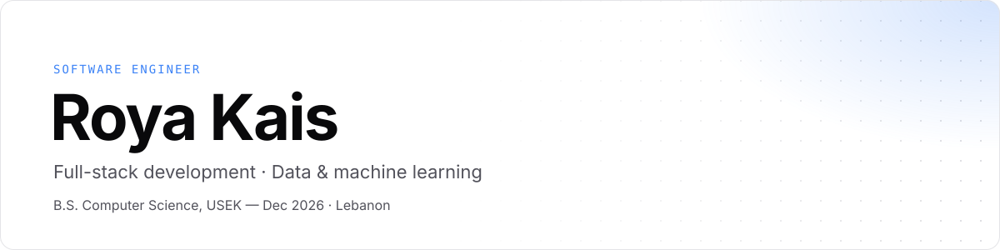

  <picture>
    <source media="(prefers-color-scheme: dark)" srcset="./assets/header-dark.svg" />
    
  </picture>

    

  
  
  

    

  

    Final-year Computer Science student at <strong>Holy Spirit University of Kaslik (USEK)</strong>, graduating December 2026. 
    I build things that actually run: relational databases, typed full-stack web apps, and ML models taken from raw data to live products. 
    <em>Currently building <strong>HomeFit</strong> (FYP) and diving deeper into Java, the JVM, and DSA.</em>
  

---

### `01` Selected Work

<table>
  <tr>
    <td width="50%" valign="top">
      <a href="https://github.com/royakais/F1_prediction"><strong>🏎️ F1 2026 Prediction Lab</strong></a> · <a href="https://f1-prediction-lab8.onrender.com/">Live Demo</a> 
      End-to-end ML system predicting Formula 1 finishing positions, served by a Flask API to an interactive site. <a href="https://github.com/royakais/MachineLearning-F1">Pipeline →</a>  
      <code>Python</code> <code>scikit-learn</code> <code>Pandas</code> <code>Flask</code>
    </td>
    <td width="50%" valign="top">
      <strong>💪 HomeFit</strong> · <em>In Progress</em> 
      No-equipment home-workout mobile app with machine-learning features built on top of guided training plans.  
      <code>Mobile</code> <code>Machine Learning</code>
    </td>
  </tr>
  <tr>
    <td width="50%" valign="top">
      <a href="https://github.com/royakais/BNF-Interpreter"><strong>🌳 BNF Interpreter</strong></a> 
      A custom language from a BNF grammar: lexer, recursive-descent parser, AST, and evaluator with a GUI syntax tree visualizer.  
      <code>Java</code> <code>Swing</code> <code>Compilers</code>
    </td>
    <td width="50%" valign="top">
      <a href="https://github.com/royakais/DBMS-VeeCoffeeShop"><strong>☕ Vee Coffee Shop DBMS</strong></a> 
      Relational database architecture for a 16-branch coffee chain, engineered from ER diagram to normalized schema.  
      <code>SQL</code> <code>Database Design</code>
    </td>
  </tr>
  <tr>
    <td width="50%" valign="top">
      <a href="https://github.com/royakais/GuessTheCapital"><strong>🌍 Guess the Capital</strong></a> 
      Keyboard-first desktop quiz featuring 96 countries wrapped in a timed, animated dark UI.  
      <code>Java</code> <code>Swing</code>
    </td>
    <td width="50%" valign="top">
      <a href="https://github.com/royakais/royakais-portfolio"><strong>🌐 Personal Portfolio</strong></a> 
      My personal corner on the internet showcasing projects, experience, and writing.  
      <code>Next.js</code> <code>TypeScript</code> <code>Tailwind</code>
    </td>
  </tr>
</table>

---

### `02` Tech Stack

  **Languages & Core**  
  

  **Web & Backend**  
  

  **Data, ML & Infrastructure**  
  

    
  <strong>Also experienced with:</strong> Pandas · NumPy · Matplotlib · Power BI · R · GitHub Actions

---

  
    Open to <strong>junior software engineering</strong> and <strong>data roles</strong> (Lebanon & Remote). 
    Let's connect on <a href="https://linkedin.com/in/royakais">LinkedIn</a> or drop an email at <a href="mailto:royakais@yahoo.com">royakais@yahoo.com</a>.
  

