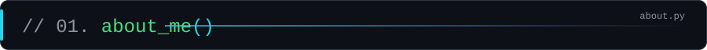
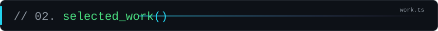
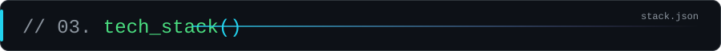
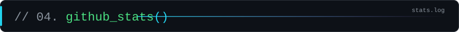
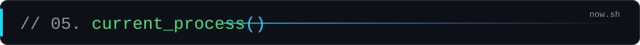
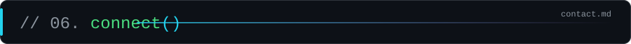

<p align="center">
  
</p>

<p align="center">
  
</p>

<p align="center">
  <a href="https://linkedin.com/in/royakais"></a>
  <a href="mailto:royakais@yahoo.com"></a>
  
  
  
</p>

<br />

<!-- ═══════════════════════ 01 · ABOUT ═══════════════════════ -->


```python
class Roya(Engineer):
    """Final-year CS student who ships things that run — not notebooks that stay notebooks."""

    role        = "Software Engineer · Full-Stack · Data & ML"
    education   = "B.S. Computer Science @ USEK — Dec 2026"
    strengths   = ["Python", "Java", "SQL / PostgreSQL", "Next.js + TypeScript"]
    building    = "HomeFit — home-workout mobile app with ML"
    learning    = ["Advanced Java & the JVM", "Data structures & algorithms"]
    languages   = {"English": "fluent", "Arabic": "native", "French": "basic"}
    looking_for = "Junior software engineering & data roles"

    def pipeline(self):
        return "raw data → relational DB → typed full-stack app → deployed ML model"
```

<br />

<!-- ═══════════════════════ 02 · WORK ═══════════════════════ -->


<table>
  <tr>
    <td width="50%" valign="top">
      <code>[0x01]</code> <sub><b>MACHINE_LEARNING</b></sub>
      <h3>🏎️ <a href="https://github.com/royakais/F1_prediction">F1 2026 Prediction Lab</a></h3>
      End-to-end ML system predicting Formula 1 finishing positions. Regression + classification models trained on 2024–2026 race data, served by a Flask API to an interactive site.
      <br /><br />
      <a href="https://f1-prediction-lab8.onrender.com/"></a>
      <a href="https://github.com/royakais/MachineLearning-F1"></a>
      <br /><br />
      <code>python</code> <code>scikit-learn</code> <code>pandas</code> <code>flask</code>
    </td>
    <td width="50%" valign="top">
      <code>[0x02]</code> <sub><b>FINAL_YEAR_PROJECT</b></sub>
      <h3>💪 HomeFit <sub><code>status: building</code></sub></h3>
      A no-equipment home-workout mobile app, with machine-learning features layered on top of guided training plans.
      <br /><br />
      
      <br /><br />
      <code>mobile</code> <code>machine-learning</code>
    </td>
  </tr>
  <tr>
    <td width="50%" valign="top">
      <code>[0x03]</code> <sub><b>LANGUAGES_&amp;_COMPILERS</b></sub>
      <h3>🧩 <a href="https://github.com/royakais/BNF-Interpreter">BNF Interpreter</a></h3>
      A small programming language built from a BNF grammar: lexer → recursive-descent parser → AST → evaluator, with a Swing GUI that visualises tokens and the syntax tree in real time.
      <br /><br />
      <code>java</code> <code>swing</code> <code>parsing</code>
    </td>
    <td width="50%" valign="top">
      <code>[0x04]</code> <sub><b>DATABASES</b></sub>
      <h3>☕ <a href="https://github.com/royakais/DBMS-VeeCoffeeShop">Vee Coffee Shop DBMS</a></h3>
      Relational database for a 16-branch coffee chain — sales, inventory, employees, suppliers and deliveries — from ER diagram to normalised schema.
      <br /><br />
      <code>sql</code> <code>er-modelling</code> <code>normalisation</code>
    </td>
  </tr>
  <tr>
    <td width="50%" valign="top">
      <code>[0x05]</code> <sub><b>DESKTOP</b></sub>
      <h3>🌍 <a href="https://github.com/royakais/GuessTheCapital">Guess the Capital</a></h3>
      Keyboard-first Java quiz with 96 countries, a colour-shifting timer, a shake-on-wrong animation and a dark theme.
      <br /><br />
      <code>java</code> <code>swing</code>
    </td>
    <td width="50%" valign="top">
      <code>[0x06]</code> <sub><b>WEB</b></sub>
      <h3>🖥️ <a href="https://github.com/royakais/royakais-portfolio">Personal Portfolio</a></h3>
      My portfolio site, built with the Next.js App Router and TypeScript.
      <br /><br />
      <code>nextjs</code> <code>typescript</code> <code>tailwindcss</code>
    </td>
  </tr>
</table>

<br />

<!-- ═══════════════════════ 03 · STACK ═══════════════════════ -->


```json
{
  "languages":  ["Python", "Java", "JavaScript", "TypeScript", "C++", "C#", "R", "SQL"],
  "web_mobile": ["React", "Next.js", "Node.js", "Express", "Redux", "Tailwind", "Flask", "FastAPI"],
  "data_ml":    ["scikit-learn", "PyTorch", "Pandas", "NumPy", "Matplotlib", "Power BI"],
  "databases":  ["PostgreSQL", "MySQL", "Prisma"],
  "devops":     ["Git", "GitHub Actions", "Linux", "Azure"]
}
```

<p align="center">
  <br />
  <br />
  
</p>
<p align="center">
  
  
  
  
</p>

<br />

<!-- ═══════════════════════ 04 · STATS ═══════════════════════ -->


<p align="center">
  
  
</p>
<p align="center">
  
</p>
<p align="center">
  
</p>

<br />

<!-- ═══════════════════════ 05 · NOW ═══════════════════════ -->


```bash
$ ps aux | grep roya

PID   PROCESS                                   STATUS
101   homefit --final-year-project              ▶ running
102   java --deep-dive oop,collections,jvm      ▶ running
103   dsa --practice --daily                    ▶ running
104   bsc-cs --graduate 2026-12                 ⏳ in progress
```

<br />

<!-- ═══════════════════════ 06 · CONTACT ═══════════════════════ -->


<p align="center">
  <code>&gt; Open to junior software engineering &amp; data roles — in Lebanon and remote.</code>
</p>

<p align="center">
  <a href="https://linkedin.com/in/royakais"></a>
  &nbsp;
  <a href="mailto:royakais@yahoo.com"></a>
  &nbsp;
  <a href="https://github.com/royakais"></a>
</p>

<br />

<p align="center">
  
</p>
