<p align="center">
  
</p>

<p align="center">
  
</p>

<p align="center">
  <a href="https://linkedin.com/in/royakais"></a>
  <a href="mailto:royakais@yahoo.com"></a>
  
  
</p>

<br />

<!-- ────────────────────────── ABOUT ────────────────────────── -->
<p align="center">
  <picture>
    <source media="(prefers-color-scheme: dark)" srcset="./assets/title-about-dark.svg" />
    
  </picture>
</p>

<p align="center">
  I'm a final-year <b>Computer Science</b> student at <b>Holy Spirit University of Kaslik (USEK)</b><br />
  who likes shipping things that actually run, not notebooks that stay notebooks.<br />
  I design relational databases, build typed full-stack web apps,<br />
  and take machine-learning models from raw data all the way to a live website.
</p>

```python
class Roya:
    role        = "Software Engineer · Full-Stack · Data & ML"
    education   = "B.S. Computer Science, USEK — Dec 2026"
    strengths   = ["Python", "Java", "SQL / PostgreSQL", "Next.js + TypeScript"]
    building    = "HomeFit — home-workout mobile app with ML"
    learning    = ["Advanced Java & the JVM", "Data structures & algorithms"]
    languages   = {"English": "fluent", "Arabic": "native", "French": "basic"}
    looking_for = "Junior software engineering & data roles"
```

<br />

<!-- ────────────────────────── WORK ────────────────────────── -->
<p align="center">
  <picture>
    <source media="(prefers-color-scheme: dark)" srcset="./assets/title-work-dark.svg" />
    
  </picture>
</p>

<table>
  <tr>
    <td width="50%" valign="top">
      <sub>I &nbsp;·&nbsp; MACHINE LEARNING</sub>
      <h3><a href="https://github.com/royakais/F1_prediction">F1 2026 Prediction Lab</a></h3>
      An end-to-end ML system that predicts Formula 1 finishing positions. Regression and classification models are trained on 2024–2026 race data and served by a Flask API to an interactive website.
      <br /><br />
      <a href="https://f1-prediction-lab8.onrender.com/"></a>
      <a href="https://github.com/royakais/MachineLearning-F1"></a>
      <br /><br />
      <code>Python</code> <code>scikit-learn</code> <code>Pandas</code> <code>Flask</code>
    </td>
    <td width="50%" valign="top">
      <sub>II &nbsp;·&nbsp; FINAL YEAR PROJECT</sub>
      <h3>HomeFit <sub><i>in progress</i></sub></h3>
      A no-equipment home-workout mobile app, with machine-learning features layered on top of guided training plans.
      <br /><br />
      
      <br /><br />
      <code>Mobile</code> <code>Machine Learning</code>
    </td>
  </tr>
  <tr>
    <td width="50%" valign="top">
      <sub>III &nbsp;·&nbsp; LANGUAGES &amp; COMPILERS</sub>
      <h3><a href="https://github.com/royakais/BNF-Interpreter">BNF Interpreter</a></h3>
      A small programming language built from a BNF grammar: lexer, recursive-descent parser, AST and evaluator, with a Swing GUI that visualises tokens and the syntax tree in real time.
      <br /><br />
      <code>Java</code> <code>Swing</code> <code>Parsing</code>
    </td>
    <td width="50%" valign="top">
      <sub>IV &nbsp;·&nbsp; DATABASES</sub>
      <h3><a href="https://github.com/royakais/DBMS-VeeCoffeeShop">Vee Coffee Shop DBMS</a></h3>
      A relational database for a 16-branch coffee chain covering sales, inventory, employees, suppliers and deliveries, from ER diagram to normalised schema.
      <br /><br />
      <code>SQL</code> <code>ER modelling</code> <code>Normalisation</code>
    </td>
  </tr>
  <tr>
    <td width="50%" valign="top">
      <sub>V &nbsp;·&nbsp; DESKTOP</sub>
      <h3><a href="https://github.com/royakais/GuessTheCapital">Guess the Capital</a></h3>
      A keyboard-first Java quiz with 96 countries, a colour-shifting timer, a shake-on-wrong animation and a dark theme.
      <br /><br />
      <code>Java</code> <code>Swing</code>
    </td>
    <td width="50%" valign="top">
      <sub>VI &nbsp;·&nbsp; WEB</sub>
      <h3><a href="https://github.com/royakais/royakais-portfolio">Personal Portfolio</a></h3>
      My portfolio site, built with the Next.js App Router and TypeScript.
      <br /><br />
      <code>Next.js</code> <code>TypeScript</code> <code>Tailwind CSS</code>
    </td>
  </tr>
</table>

<br />

<!-- ────────────────────────── TOOLKIT ────────────────────────── -->
<p align="center">
  <picture>
    <source media="(prefers-color-scheme: dark)" srcset="./assets/title-stack-dark.svg" />
    
  </picture>
</p>

<p align="center"><sub>LANGUAGES</sub><br /></p>
<p align="center"><sub>WEB &amp; MOBILE</sub><br /></p>
<p align="center"><sub>DATA, ML &amp; DATABASES</sub><br /></p>
<p align="center">
  
  
  
  
</p>
<p align="center"><sub>TOOLS &amp; CLOUD</sub><br /></p>

<br />

<!-- ────────────────────────── NOW ────────────────────────── -->
<p align="center">
  <picture>
    <source media="(prefers-color-scheme: dark)" srcset="./assets/title-now-dark.svg" />
    
  </picture>
</p>

<p align="center">
  Building <b>HomeFit</b>, my final year project<br />
  ◆<br />
  Deepening <b>Java</b>: OOP, collections, the JVM and concurrency<br />
  ◆<br />
  Practising <b>data structures &amp; algorithms</b> daily<br />
  ◆<br />
  Finishing my <b>B.S. in Computer Science</b> in December 2026
</p>

<br />

<!-- ────────────────────────── CONTACT ────────────────────────── -->
<p align="center">
  <picture>
    <source media="(prefers-color-scheme: dark)" srcset="./assets/title-contact-dark.svg" />
    
  </picture>
</p>

<p align="center">
  <i>Open to junior software engineering and data opportunities, in Lebanon and remotely.</i>
</p>

<p align="center">
  <a href="https://linkedin.com/in/royakais"></a>
  &nbsp;
  <a href="mailto:royakais@yahoo.com"></a>
</p>

<br />

<p align="center">
  
</p>
